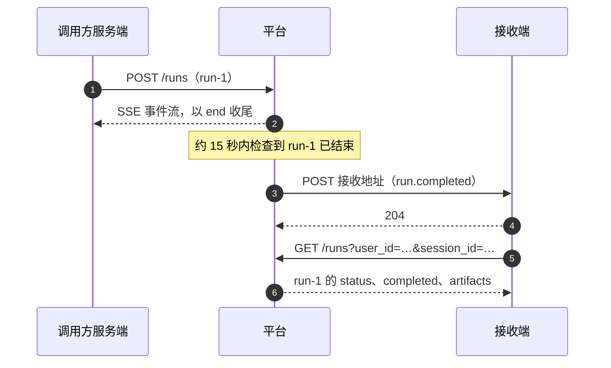

# 11 Webhook 通知

Webhook 通知由平台主动发起：run 结束、出现待审批等事件发生后，平台向租户登记的接收地址发送一条 HTTP POST。接收端（调用方用来接收通知的 HTTP 服务）要做三件事：校验签名、按 `event_id` 去重、尽快返回 2xx。

通知只说明「有事发生」。**一次 run 的结果以 [3.4 的 `end`](./sse-events#end) 事件或 [5.4 run 列表](./query#_5-4-run-列表) 为准**，通知与这两者的关系见 [11.9](#_11-9-与-end-事件和-run-列表的关系)。

管理控制台里另有一种「webhook 触发器」，方向相反：由外部系统调用平台来启动 Agent，不在本章范围内。

## 11.1 一次通知的过程



- 平台大约每 15 秒检查一次新事件，通知比 SSE 的 `end` 晚到，不是实时推送。
- 同一租户的通知并发发送，不保证先后顺序，见 [11.8 去重与顺序](#_11-8-去重与顺序)。
- 接收端返回 5xx、429 或者超时，平台按退避间隔重试；返回其它 4xx 时不重试，见 [11.7 响应与重试](#_11-7-响应与重试)。

## 11.2 开通与管理

Webhook 端点（一个接收地址加上它订阅的事件类型）只能由租户管理员在管理控制台的「Webhook」页面创建、修改和删除。对外 API 的 key 不能管理端点，用 key 调用这组管理接口会返回 403。

新建端点时填写以下几项：

| 项目 | 必填 | 说明 |
|---|---|---|
| 名称 | 是 | 租户内唯一，长度 1–64 字符 |
| 投递 URL | 是 | 接收通知的地址，最长 2048 字符。只接受 `http` 与 `https`，主机不能是 `localhost`，也不能是内网 IP；建议使用 `https` |
| 事件类型 | 是 | 至少选一个，取值见 [11.3 事件一览](#_11-3-事件一览) |
| 智能体范围 | 否 | 填一个 `agent_code`，端点只接收这个 Agent 的事件；留空则接收租户内全部 Agent 的事件 |
| 投递格式 | 否 | 取值：通用（默认，带签名的 JSON，见 [11.4](#_11-4-请求格式)）/ 飞书机器人 / 钉钉机器人 / 企业微信机器人（见 [11.10](#_11-10-im-机器人格式)） |

创建成功后，控制台显示这个端点的签名密钥，**密钥只显示这一次，之后无法再查看**。请把它交给接收端，保存在密钥管理服务或环境变量里，校验方法见 [11.6 校验签名](#_11-6-校验签名)。

其它规则：

- 每个租户最多 50 个端点。
- 端点可以在控制台停用和重新启用。停用期间不再产生新的通知，已经排队、还没送达的通知直接放弃。
- 密钥不能单独更换。要更换密钥，删除这个端点后重新创建，新端点会得到新的密钥。
- 删除端点会同时删除它尚未送达的通知。重新创建的端点会补发最近一批事件，见 [11.8](#_11-8-去重与顺序)。

## 11.3 事件一览

| 事件 | 出现时机 | `event_id` 的格式 |
|---|---|---|
| `run.completed` | run 以 `success` 或 `incomplete` 结束 | `run:{run_id}` |
| `run.failed` | run 以其余最终状态结束：`error`、`interrupted`，以及停在人工审批处的 `paused` | `run:{run_id}` |
| `approval.requested` | 出现一条等待人工决策的审批 | `approval:{approval_id}` |
| `artifact.saved` | Agent 登记了一个产物，或者给已有产物登记了新版本 | `artifact:{artifact_id}:v{version}` |
| `skill_promote.requested` | Agent 申请把自己的一个技能共享给整个租户，等待租户管理员审核 | `skill_promote:{request_id}` |
| `quality.drift` | 平台的质量监控发现某个 Agent 近期的回答评分明显低于基线 | `quality_drift:{alert_id}` |

端点只会收到它订阅的事件类型。平台后续可能新增事件类型，已有端点的订阅不会因此改变。

::: warning `run.failed` 也包括等待审批的 run
`run.failed` 覆盖 `success` 与 `incomplete` 之外的全部最终状态，其中包括 `paused`：run 停在人工审批处等待决策，并没有失败。

只凭事件名把这一轮标成失败，会把等待审批的对话误报成失败。先读 `payload` 里的 `status`，见 [11.5](#run-completed-与-run-failed)。
:::

::: warning `run.completed` 不代表要做的事已经做成
被平台的步数、token 预算或无进展限制截停的 run 也发 `run.completed`，此时 `status` 为 `incomplete`。

`status` 为 `success` 时，要做的事也可能没有做成，例如审批被拒绝或者有工具失败没有恢复。判断这一轮是否交付，看 `payload` 里的 `completed`。
:::

各事件的发送规则：

- `run.completed` 与 `run.failed`：每个 run 只发一次，`status` 是平台生成这条通知时的状态。`paused` 的 run 之后因同一会话发起新一轮而变为 `interrupted` 时，不会再发通知（见 [4.2 决策之前发起新一轮](./run-control#决策之前发起新一轮)）；审批决策之后的续跑使用新的 `run_id`，它结束时另发一条。
- 这两个事件覆盖租户内（或端点限定的那个 Agent 上）的全部 run，包括不是由这个调用方发起的 run，例如管理控制台里的调试对话。收到不认识的 `run_id` 时直接返回 2xx 并忽略。
- `approval.requested`：只针对平台检查时仍在等待决策的审批。审批在发起后十几秒内就被决定时，可能不会产生这条通知。
- `artifact.saved`：只发给没有限定智能体范围的端点。平台检查时只看每个产物的最新版本，两次检查之间连续登记的多个版本只通知最后一个。

## 11.4 请求格式

平台用 `POST` 请求把通知发到端点的投递 URL，不跟随重定向。下面说明投递格式为「通用」时的请求；IM 机器人格式见 [11.10](#_11-10-im-机器人格式)。

| 请求头 | 说明 |
|---|---|
| `Content-Type` | 固定为 `application/json` |
| `X-Expert-Work-Signature-256` | 请求体的签名，形如 `sha256=` 加 64 位小写十六进制，校验方法见 [11.6](#_11-6-校验签名) |
| `X-Expert-Work-Event` | 事件类型，与请求体里的 `event_type` 相同 |
| `X-Expert-Work-Delivery` | 这次投递的 id，UUID。同一条通知重试时不变 |

请求体的字段：

| 字段 | 类型 | 说明 |
|---|---|---|
| `event_id` | string | 事件标识，格式见 [11.3](#_11-3-事件一览)。同一个事件发给多个端点、重试、端点重建后补发，都是同一个值，去重用它 |
| `event_type` | string | 事件类型，取值见 [11.3](#_11-3-事件一览) |
| `occurred_at` | string（ISO 8601） | 平台生成这条通知的时间，带时区偏移。它不是事件本身的发生时间，run 的结束时间见 [5.4 run 列表](./query#_5-4-run-列表) 的 `finished_at` |
| `tenant_id` | string（UUID） | 租户标识。一个接收地址同时服务多个租户时，用它区分来源 |
| `payload` | object | 事件的内容，字段随 `event_type` 变化，见 [11.5](#_11-5-各事件的-payload) |

请求体的字节有三个特点，校验签名时会用到：

- 没有空格和换行，各层对象的键按字母顺序排列。
- 非 ASCII 字符写成 `\uXXXX` 转义，例如汉字。标准 JSON 解析器会把它们还原成原字符。
- 同一条通知每次重试，请求体逐字节相同。

下面是一条 `run.completed` 通知的请求体。为便于阅读，本章的示例都已格式化，汉字也已还原；实际收到的是一整行，汉字是 `\uXXXX` 转义。

```json [请求体]
{
  "event_id": "run:3d8b5f20-6a1e-4c9b-8f02-7e4d1c6a9b53",
  "event_type": "run.completed",
  "occurred_at": "2026-10-28T06:31:52.104233+00:00",
  "payload": {
    "completed": false,
    "exit_reason": "max_steps",
    "run_id": "3d8b5f20-6a1e-4c9b-8f02-7e4d1c6a9b53",
    "status": "incomplete",
    "thread_id": "9f2c1a44-6d3b-4f18-9a70-2b5c8e1d0c37",
    "unresolved_failures": [
      {
        "kind": "unknown",
        "tool": "bash"
      }
    ]
  },
  "tenant_id": "5b0c2e7a-91d4-4f3e-8a6b-2c7d9e1f4a30"
}
```

这次 run 用完了步数，平台让 Agent 收尾，所以 `status` 是 `incomplete`、`completed` 是 `false`；`bash` 工具有一次失败到结束时仍未解决。

`payload` 里没有值的字段是 `null`。平台后续可能新增字段，接收端遇到不认识的字段时忽略即可。

## 11.5 各事件的 `payload`

### `run.completed` 与 `run.failed`

两个事件的 `payload` 结构相同：

| 字段 | 类型 | 说明 |
|---|---|---|
| `run_id` | string（UUID） | 这次 run 的标识 |
| `thread_id` | string（UUID） | 这次 run 所属的会话，与对外接口里的 `session_id` 同值 |
| `status` | string | run 的最终状态，取值与 [5.4 run 列表](./query#status-的取值) 的 `status` 相同。`run.completed` 只带 `success` 或 `incomplete`，`run.failed` 带其余最终状态 |
| `completed` | boolean \| null | 要做的事有没有做成，与 5.4 run 列表的同名字段相同。`null` 表示没有记录，多见于失败、被取消的 run，不要当成 `false` |
| `exit_reason` | string \| null | run 从哪个出口结束，取值与 5.4 run 列表的同名字段相同。`null` 的含义与 `completed` 相同 |
| `unresolved_failures` | array \| null | 到 run 结束时仍未解决的工具失败，最多 20 条，元素结构见下表。`[]` 表示没有；`null` 表示没有记录，多见于失败、被取消的 run，以及这次变更之前结束的 run（这时 `completed` 可能有值），按「不清楚」处理，不要当成 `[]` |

`status`、`completed`、`exit_reason` 三个字段的完整读法见 [3.4 的 `end`](./sse-events#end)。`status` 说的是这次 run 怎么结束的，`completed` 说的是要做的事做成了没有，`unresolved_failures` 说的是没做成时哪些工具失败了。

`unresolved_failures` 每个元素的字段：

| 字段 | 类型 | 说明 |
|---|---|---|
| `tool` | string | 失败的工具名。平台读不到工具名时是空字符串 |
| `kind` | string | 失败类型。开放取值，当前常见：`unknown`（未归类）/ `blocked_by_policy`（被平台策略拦下）/ `invalid_arguments`（参数不合法）/ `resource_not_found`（目标不存在）/ `permission_denied`（没有权限）/ `mutation_not_landed`（写操作报告成功但没有生效）/ `unknown_tool`（调用了不存在的工具）；遇到未知值时原样显示 |

元素里只有工具名和失败类型，不含调用参数、文件路径或工具输出。它适合展示给排查问题的内部人员，不建议直接展示给终端用户。

下面是一个停在人工审批处的 run 发出的 `run.failed`。它没有失败，等待的审批见同一会话的 `approval.requested`。

```json [请求体]
{
  "event_id": "run:67262572-5470-41a4-800d-592762ec679d",
  "event_type": "run.failed",
  "occurred_at": "2026-10-28T06:31:52.104233+00:00",
  "payload": {
    "completed": false,
    "exit_reason": "approval_pending",
    "run_id": "67262572-5470-41a4-800d-592762ec679d",
    "status": "paused",
    "thread_id": "9f2c1a44-6d3b-4f18-9a70-2b5c8e1d0c37",
    "unresolved_failures": []
  },
  "tenant_id": "5b0c2e7a-91d4-4f3e-8a6b-2c7d9e1f4a30"
}
```

### `approval.requested`

| 字段 | 类型 | 说明 |
|---|---|---|
| `approval_id` | string（UUID） | 平台审批记录的标识。对外接口不使用它，提交决策时按 `run_id` 定位 |
| `run_id` | string（UUID） | 停下来等待审批的 run |
| `thread_id` | string（UUID） | 这次 run 所属的会话，与 `session_id` 同值 |
| `request_id` | string | 这条审批请求的 id，与 SSE `approval` 事件里的 `request_id` 相同 |
| `action_summary` | string | 一句话说明在等待批准什么 |
| `reason_kind` | string | 为什么要审批，五个取值与 [3.4 的 `approval`](./sse-events#approval) 相同 |
| `binding` | string \| null | 参数绑定摘要的前 12 位，客户端不需要处理。没有绑定摘要时为 `null` |

这条通知不带待批准的参数、超时时间和终端用户。要提交决策，按 `run_id` 在调用方自己的记录里找到发起这次 run 时用的 `agent_code` 与 `user_id`，再调用 [4.2 审批决策](./run-control#_4-2-审批决策)。审批界面需要的完整信息在 SSE 的 `approval` 事件里，这条通知不能替代它。

```json [请求体]
{
  "event_id": "approval:a3f8c1d6-7e24-4b59-9c0a-1d5e8f2b7c63",
  "event_type": "approval.requested",
  "occurred_at": "2026-10-28T06:31:52.104233+00:00",
  "payload": {
    "action_summary": "即将向 finance@example.com 发送一封含转账明细的邮件",
    "approval_id": "a3f8c1d6-7e24-4b59-9c0a-1d5e8f2b7c63",
    "binding": "9b1f3c7a5d2e",
    "reason_kind": "policy_gate",
    "request_id": "apr_5f3a91c2e7b04d68",
    "run_id": "67262572-5470-41a4-800d-592762ec679d",
    "thread_id": "9f2c1a44-6d3b-4f18-9a70-2b5c8e1d0c37"
  },
  "tenant_id": "5b0c2e7a-91d4-4f3e-8a6b-2c7d9e1f4a30"
}
```

### `artifact.saved`

| 字段 | 类型 | 说明 |
|---|---|---|
| `artifact_id` | string（UUID） | 平台产物记录的标识。对外接口按产物 `name` 定位，不使用它 |
| `name` | string | 产物名，与 [5.7 产物](./query#_5-7-产物) 里的 `name` 相同 |
| `kind` | string | 内容类别，与 [3.4 的 `end`](./sse-events#end) 里产物清单的 `kind` 相同 |
| `version` | integer | 这次登记的版本号，从 1 起 |

这条通知不带终端用户、会话、run 和 Agent，所以只发给没有限定智能体范围的端点。一轮登记了哪些产物，以 `end` 事件或 5.4 run 列表的 `artifacts` 为准。

```json [请求体]
{
  "event_id": "artifact:c7e2a9f4-3b18-4d6c-a05e-9f1b2d8c4e71:v1",
  "event_type": "artifact.saved",
  "occurred_at": "2026-10-28T06:31:52.104233+00:00",
  "payload": {
    "artifact_id": "c7e2a9f4-3b18-4d6c-a05e-9f1b2d8c4e71",
    "kind": "document",
    "name": "续约建议_20260812.docx",
    "version": 1
  },
  "tenant_id": "5b0c2e7a-91d4-4f3e-8a6b-2c7d9e1f4a30"
}
```

### `skill_promote.requested`

Agent 可以申请把自己创建的技能共享给租户内的全部 Agent，申请由租户管理员在管理控制台审核。这个事件通常订阅到管理员的 IM 群，对接业务时一般不需要。

| 字段 | 类型 | 说明 |
|---|---|---|
| `request_id` | string（UUID） | 这条共享申请的标识 |
| `skill_id` | string（UUID） | 申请共享的技能 |
| `skill_version` | integer | 申请共享的技能版本，从 1 起 |
| `requested_by_agent_name` | string \| null | 提出申请的 Agent 的 `agent_code`。为 `null` 时，这条通知只发给没有限定智能体范围的端点 |
| `reason` | string | 申请理由，可能是空字符串 |

```json [请求体]
{
  "event_id": "skill_promote:6a2d9e17-4c3b-48f5-b1a0-7e9c2f5d8b34",
  "event_type": "skill_promote.requested",
  "occurred_at": "2026-10-28T06:31:52.104233+00:00",
  "payload": {
    "reason": "整理出的周报模板可供其它 Agent 复用",
    "request_id": "6a2d9e17-4c3b-48f5-b1a0-7e9c2f5d8b34",
    "requested_by_agent_name": "report-writer",
    "skill_id": "f19c4b7e-2d58-4a3f-8e61-0b7d3c9a5e28",
    "skill_version": 3
  },
  "tenant_id": "5b0c2e7a-91d4-4f3e-8a6b-2c7d9e1f4a30"
}
```

### `quality.drift`

平台对 Agent 的回答抽样评分，并比较近期窗口与基线窗口的平均分。近期平均分低于基线超过设定比例时发出这个事件，同一个 Agent 在冷却时间内只发一次。窗口长度、比例与冷却时间由平台配置。

| 字段 | 类型 | 说明 |
|---|---|---|
| `agent_name` | string | 评分下降的 Agent 的 `agent_code` |
| `recent_mean` | number | 近期窗口的平均分 |
| `baseline_mean` | number | 基线窗口的平均分 |
| `drift_pct` | number | 下降比例，等于（`baseline_mean` − `recent_mean`）÷ `baseline_mean`，例如 `0.2164` 表示下降约 21.6% |
| `recent_count` | integer | 近期窗口的评分样本数 |
| `baseline_count` | integer | 基线窗口的评分样本数 |
| `detected_at` | string | 平台发现下降的时间，ISO 8601；取不到时为空字符串 |

评分是统计信号，不是原因诊断，适合提醒人去查看近期的对话。

```json [请求体]
{
  "event_id": "quality_drift:2e7b4f91-8c35-4d0a-b6e2-5f1a9c3d7b48",
  "event_type": "quality.drift",
  "occurred_at": "2026-10-28T06:31:52.104233+00:00",
  "payload": {
    "agent_name": "report-writer",
    "baseline_count": 168,
    "baseline_mean": 0.781,
    "detected_at": "2026-10-28T06:00:00.512340+00:00",
    "drift_pct": 0.2164,
    "recent_count": 24,
    "recent_mean": 0.612
  },
  "tenant_id": "5b0c2e7a-91d4-4f3e-8a6b-2c7d9e1f4a30"
}
```

## 11.6 校验签名

签名是用端点的签名密钥对请求体原始字节计算的 HMAC-SHA256。接收端每收到一条通知都要校验，校验不通过时返回 401，不处理这条通知。

步骤：

1. 在解析 JSON 之前，先取到请求体的原始字节。
2. 把签名密钥按原样作为 UTF-8 字节，对原始字节计算 HMAC-SHA256，得到小写十六进制串。密钥看起来像 Base64，但不要解码。
3. 在十六进制串前面加上 `sha256=`，与请求头 `X-Expert-Work-Signature-256` 比较。比较用常量时间的函数，不要用普通的字符串相等。
4. 相等才解析 JSON、继续处理。

::: warning 必须对收到的原始字节计算签名
先解析再重新序列化，得到的字节与平台签名时的字节不同，签名必然对不上。例如 `JSON.stringify(JSON.parse(body))` 会把 `\u7eed\u7ea6` 还原成汉字，Python 的 `json.dumps` 会在冒号和逗号后面加空格。

很多 Web 框架默认先把 JSON 请求体解析成对象，接收通知的这个路由要改为读取原始字节，写法见下面的示例代码。
:::

签名不含时间戳。按 [11.8](#_11-8-去重与顺序) 用 `event_id` 去重，同一条通知被重复发送时不会被处理两次。

### 示例代码

```python [示例代码 Python]
import hashlib
import hmac


def verify_signature(secret: str, body: bytes, header: str | None) -> bool:
    expected = "sha256=" + hmac.new(secret.encode("utf-8"), body, hashlib.sha256).hexdigest()
    return hmac.compare_digest(expected, header or "")
```

在 Flask 里用 `request.get_data()` 取原始字节，FastAPI 用 `await request.body()`：

```python [示例代码 Flask]
import json
import os

from flask import Flask, request

app = Flask(__name__)
WEBHOOK_SECRET = os.environ["EXPERT_WORK_WEBHOOK_SECRET"]


@app.post("/expert-work/webhook")
def receive():
    body = request.get_data()  # 原始字节,在解析 JSON 之前读取
    if not verify_signature(WEBHOOK_SECRET, body, request.headers.get("X-Expert-Work-Signature-256")):
        return "", 401
    event = json.loads(body)
    if store.add_if_absent(event["event_id"], event):  # 已经收到过的 event_id 返回 False
        queue.put(event["event_id"])                    # 交给后台处理,不在这里查询 run 列表
    return "", 204
```

```js [示例代码 Node.js]
const crypto = require("node:crypto");

function verifySignature(secret, rawBody, header) {
  const expected = Buffer.from(
    "sha256=" + crypto.createHmac("sha256", secret).update(rawBody).digest("hex"),
  );
  const received = Buffer.from(header ?? "");
  return expected.length === received.length && crypto.timingSafeEqual(expected, received);
}
```

在 Express 里给这个路由单独挂 `express.raw()`，`req.body` 就是原始字节；不要让这个路由先经过 `express.json()`：

```js [示例代码 Express]
const express = require("express");

const app = express();

app.post("/expert-work/webhook", express.raw({ type: "application/json" }), (req, res) => {
  const secret = process.env.EXPERT_WORK_WEBHOOK_SECRET;
  if (!verifySignature(secret, req.body, req.get("X-Expert-Work-Signature-256"))) {
    return res.sendStatus(401);
  }
  const event = JSON.parse(req.body.toString("utf8"));
  if (store.addIfAbsent(event.event_id, event)) {  // 已经收到过的 event_id 返回 false
    queue.push(event.event_id);                     // 交给后台处理,不在这里查询 run 列表
  }
  res.sendStatus(204);
});
```

### 校验用的样例

用下面三项自测签名代码：用这个密钥对这段请求体计算，结果应当与签名请求头完全一致。请求体是一整行，末尾没有换行。

``` [密钥]
kq7Xb2Lr9TzP4mWc8NvJ1sHd6FyQ3gAe0uRo5iKt2bE
```

``` [请求体原始字节]
{"event_id":"artifact:c7e2a9f4-3b18-4d6c-a05e-9f1b2d8c4e71:v1","event_type":"artifact.saved","occurred_at":"2026-10-28T06:31:52.104233+00:00","payload":{"artifact_id":"c7e2a9f4-3b18-4d6c-a05e-9f1b2d8c4e71","kind":"document","name":"\u7eed\u7ea6\u5efa\u8bae_20260812.docx","version":1},"tenant_id":"5b0c2e7a-91d4-4f3e-8a6b-2c7d9e1f4a30"}
```

``` [签名请求头]
X-Expert-Work-Signature-256: sha256=4b6f5bb6a3bc54b2baafd33dbf2ffdbdee6d8a969d2b32cb56fbc9761ebbdf89
```

这段请求体里的产物名含汉字，先解析再重新序列化之后计算，结果会与上面的签名不同，可以借此确认代码用的是原始字节。

## 11.7 响应与重试

接收端要在 10 秒内返回 2xx。平台只看 HTTP 状态码，响应体的内容不影响结果；建立连接、发送请求、等待响应各有 10 秒的超时，超时按失败处理。

| 接收端的响应 | 平台的处理 |
|---|---|
| 2xx | 投递成功，这条通知不再发送 |
| 408、429、5xx | 稍后重试 |
| 3xx | 稍后重试。平台不跟随重定向，接收地址变化时请租户管理员修改端点 |
| 其它 4xx，例如 400、401、403、404 | 不重试，这条通知就此放弃 |
| 超时或连接失败 | 稍后重试 |

重试的规则：

- 一条通知最多尝试 5 次。每次失败后依次等待约 1 分钟、5 分钟、30 分钟、2 小时再试，第 5 次仍失败就放弃。实际间隔还会多出最多约 15 秒，这是平台检查新事件的周期。
- 同一个端点连续 5 次可重试的失败之后，平台暂停向它投递约 5 分钟。暂停期间的通知顺延，不计入尝试次数。
- 放弃之后平台不再发送这条通知，对外也没有查询投递记录或手动重发的接口。漏掉的结果用 [5.4 run 列表](./query#_5-4-run-列表) 补齐，见 [11.9](#_11-9-与-end-事件和-run-列表的关系)。

**暂时处理不了的通知要返回 5xx 或 429，不要返回其它 4xx**，否则平台不会重试。建议的处理顺序是：校验签名，按 `event_id` 记下这条通知，返回 2xx，再在后台做查询和业务处理。在返回之前同步调用平台接口，容易超过 10 秒而触发重复发送。

## 11.8 去重与顺序

### 同一个事件可能收到多次

平台保证每条通知至少送达一次，不保证只送达一次。以下情况都会让同一个事件再次到达：

- 接收端已经处理，但响应超过 10 秒或者连接中断，平台按失败重试。
- 平台在投递过程中发生故障切换，约 5 分钟后重新发送尚未确认结果的通知。
- 端点删除后重新创建，平台向新端点补发最近一批事件，其中包括旧端点已经收到过的。

去重用请求体里的 `event_id`：把处理过的 `event_id` 存下来，再次收到时直接返回 2xx，不重复处理。不要用 `X-Expert-Work-Delivery` 去重，它只在同一个端点的重试之间不变；端点重建之后，或者多个端点指向同一个接收地址时，同一个事件会带不同的投递 id。

### 补发最近一批事件

新建端点、给端点增加事件类型、停用后重新启用时，平台会把最近一批已经发生、而这个端点还没收到过的同类事件也发过来：

- `run.completed` 与 `run.failed`：最近结束的一批 run。
- `approval.requested`：仍在等待决策的审批。
- `skill_promote.requested`：仍在等待审核的共享申请。
- `artifact.saved`：每个现存产物的最新版本。

补发的事件与正常的通知格式相同，同样按 `event_id` 去重。只要接收端的处理是幂等的，补发就不会带来副作用。

### 不保证顺序

平台按批并发发送通知，同一租户同时最多 4 个请求，到达顺序不代表事件的发生顺序：

- 重试的通知会晚于之后才发生的事件到达。
- 同一次暂停产生的 `approval.requested` 与 `run.failed` 先后不定。
- `occurred_at` 也不能用来排序：同一批生成的通知，这个时间相同。

需要某个 run 的最新状态时，查 [5.4 run 列表](./query#_5-4-run-列表)，不要根据通知的到达顺序推断。

## 11.9 与 end 事件和 run 列表的关系

三者的分工：

| 来源 | 适用情形 | 定位 |
|---|---|---|
| SSE 的 [`end` 事件](./sse-events#end) | 调用方自己接着事件流、实时展示这一轮 | 结果依据 |
| [5.4 run 列表](./query#_5-4-run-列表) | 事后查询，或者对账 | 结果依据 |
| Webhook 通知 | 没有接着事件流时，得知某个 run 已经结束或者需要审批 | 提示，不作为结果依据 |

通知只作提示，原因有四点：它比 `end` 晚到；它可能重复到达；重试用尽之后它会丢失；它的 `status` 是生成通知时的状态，之后的变化不会再通知。

收到 `run.completed` 或 `run.failed` 之后，建议这样取结果：

1. 校验签名，按 `event_id` 去重。
2. 按 `run_id` 在调用方自己的记录里找到发起这次 run 时用的 `agent_code` 与 `user_id`。找不到时说明这个 run 不是这个调用方发起的，忽略即可。
3. 调用 `GET /v1/agents/{agent_code}/runs?user_id={user_id}&session_id={thread_id}`，在返回的列表里找到这个 `run_id`，以它的 `status`、`completed`、`exit_reason`、`artifacts` 为准。

通知可能丢失，调用方还应当定期对账：对一段时间内仍没有收到通知的 run，主动查一次 5.4 run 列表。

## 11.10 IM 机器人格式

投递格式选择飞书、钉钉或企业微信机器人时，投递 URL 填对应平台的自定义机器人地址，平台把通知改写成一条纯文本消息发到群里。这三种格式供人阅读，没有可供程序解析的结构，调用方自己的服务请使用通用格式。

飞书机器人的请求体：

```json [请求体]
{
  "msg_type": "text",
  "content": {
    "text": "【Expert Work】运行完成\ncompleted: false\nexit_reason: max_steps\nrun_id: 3d8b5f20-6a1e-4c9b-8f02-7e4d1c6a9b53\nstatus: incomplete\nthread_id: 9f2c1a44-6d3b-4f18-9a70-2b5c8e1d0c37\nevent: run.completed\ndelivery: e4b1c7d2-5f38-4a96-b0e3-8c2d7f1a9b65"
  }
}
```

钉钉与企业微信机器人的请求体相同：

```json [请求体]
{
  "msgtype": "text",
  "text": {
    "content": "【Expert Work】运行完成\ncompleted: false\nexit_reason: max_steps\nrun_id: 3d8b5f20-6a1e-4c9b-8f02-7e4d1c6a9b53\nstatus: incomplete\nthread_id: 9f2c1a44-6d3b-4f18-9a70-2b5c8e1d0c37\nevent: run.completed\ndelivery: e4b1c7d2-5f38-4a96-b0e3-8c2d7f1a9b65"
  }
}
```

消息文本的规则：

- 第一行是 `【Expert Work】` 加上事件的中文标题，例如「运行完成」「运行失败」「审批待处理」。
- 之后按字段名的字母顺序，每行一个 `payload` 字段。值为 `null`、数组或对象的字段不显示，例如 `unresolved_failures`。
- 最后两行是事件类型与投递 id。

这三种格式同样带 [11.4](#_11-4-请求格式) 所列的请求头，签名按实际发送的请求体计算；平台不计算各 IM 平台机器人自己的签名。平台只看 HTTP 状态码：机器人返回 200、在响应体里报告错误时，平台按投递成功处理，不会重试。
